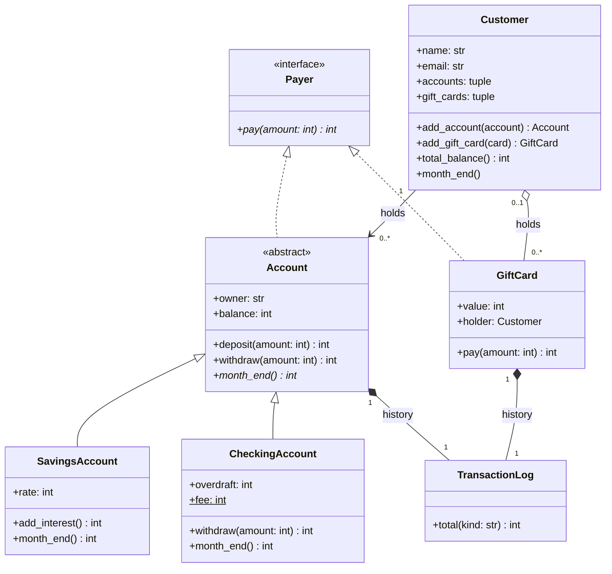
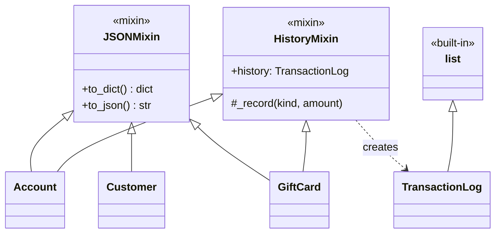
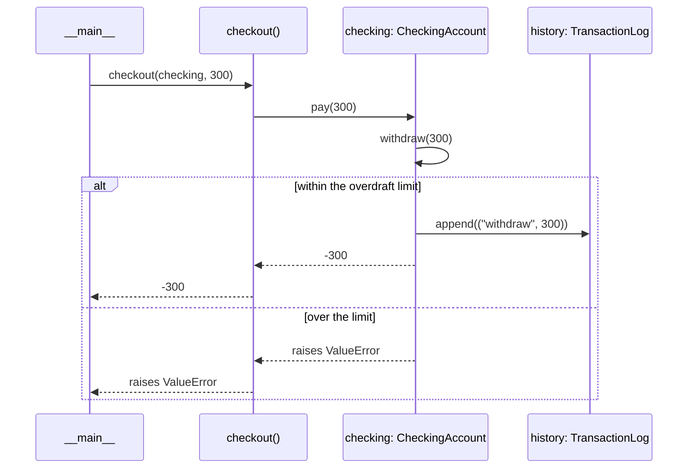
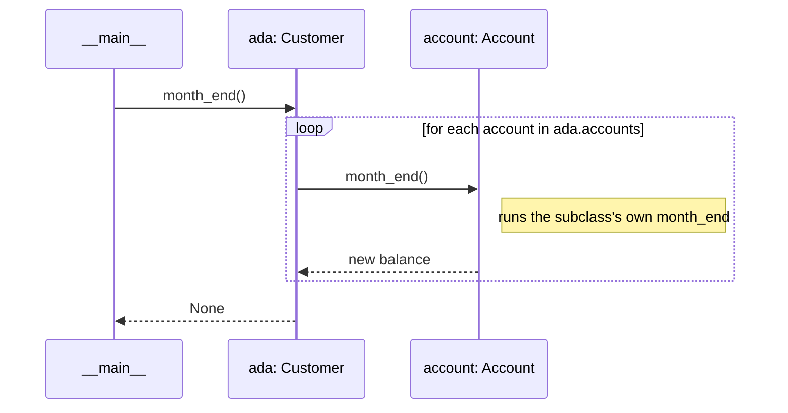

# Design

The wallet's design, drawn in [Mermaid](https://mermaid.js.org). GitHub draws these
diagrams directly. They are explained in the
[UML](https://evisp.github.io/augmented_software_engineering/02-foundations/oop/uml/)
and [Design Patterns](https://evisp.github.io/augmented_software_engineering/02-foundations/oop/design-patterns/)
tutorials.

## Domain

## How the code shares behaviour

## Paying with checkout()

## End of the month

